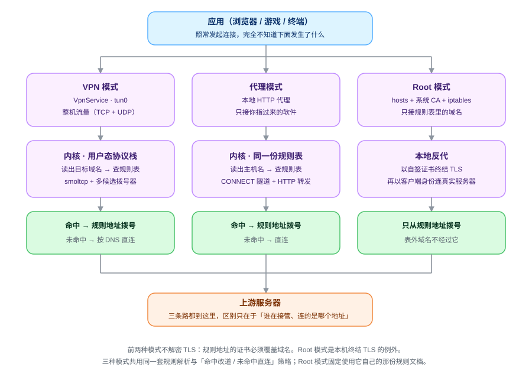
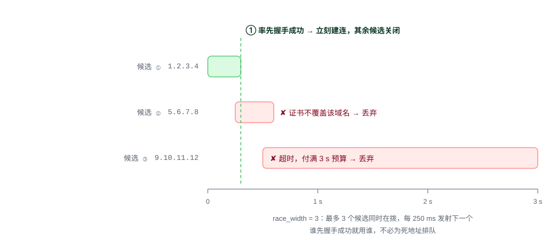
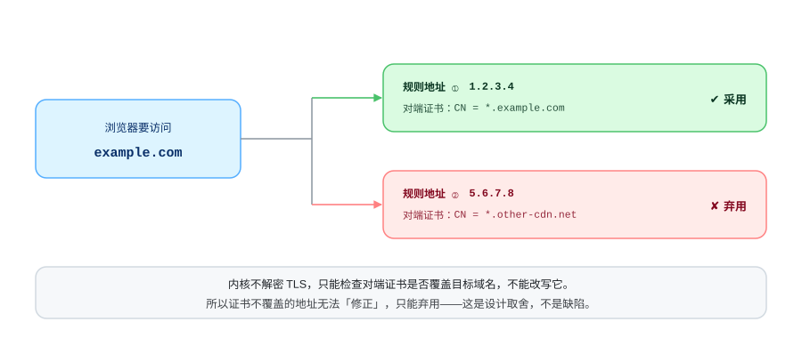
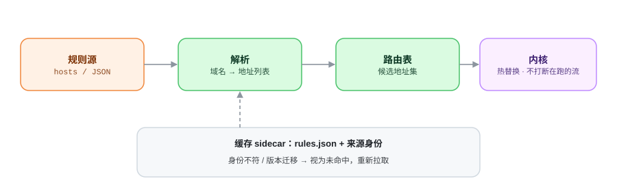

<div align="center">

# speed

[简体中文](README.md) · [**English**](README.en.md)

**A network detour tool for Android · root-free by default**

Domains named in the rule table are dialled at the addresses the table gives; everything else connects directly.

[](LICENSE)
[-3ddc84.svg)](#download)
[](#download)
[](../../releases/latest)

[Download](#download) · [How it works](#how-it-works) · [Build from source](#build-from-source) · [Disclaimer](DISCLAIMER.md)

</div>

---

## What problem this solves

Some services are unreachable on your network — not because the service is down, but because **the address its
domain resolves to** does not work from where you are. The same service usually has entrances at several
addresses, and switching to another one connects. The only problem is that you do not know which one.

`speed` fills that gap: it carries a rule table of "domain → known-good addresses" and steps in before the system
hands the connection out. If the domain is in the table, it dials the table's address instead.

The two default modes need no root, no certificate and no framework. If your device is already rooted, there is a
third mode — a different route entirely: it needs root, and it terminates TLS on the device.

There are three ways to take over, in one APK, switched on the connection page:

| | VPN mode | Proxy mode | Root mode |
| --- | --- | --- | --- |
| Takes over | all public traffic; LAN stays direct | only apps pointed at the HTTP proxy | only the domains in the rule table (system hosts) |
| Coverage | all TCP + UDP | TCP only, and only for apps with the proxy set | TCP **443** only |
| System permission | one VPN authorisation | none | root |
| Decrypts TLS | no | no | **yes** (certificate minted on device, upstream not validated) |
| Kernel settings | everything on the settings page applies | **do not apply**; the kernel's fixed set is used | **do not apply**; the kernel's fixed set is used |
| Good for | phones, tablets | emulators, environments that cannot authorise, accelerating a single app | rooted devices that need the "rule address's certificate does not match" case |

**In the first two modes, a domain the rules do not name connects directly** — the rule table answers "which
address should be tried first", not "is this allowed out". Root mode only takes over the domains in the table;
traffic it does not name never passes through it.

## How it works

All three modes share one kernel and one rule table. What differs is **where the traffic enters** and **whether
TLS is terminated**:

<div align="center">
<picture>
<source media="(prefers-color-scheme: dark)" srcset="assets/flow-dark.svg">

</picture>
</div>

### What happens inside one connection

1. An app opens a connection to a domain, as usual — it does not know any of this is happening.
2. The system hands that traffic to `speed`: `VpnService` takes over the whole device through `tun0`.
3. The kernel terminates the connection **in userspace** (it carries its own TCP/IP stack) and reads the domain out of it.
4. It looks the domain up in the rule table:
   - **named** → the system DNS answer is ignored and the rule's addresses are dialled instead;
   - **not named** → the system DNS answer is used as-is, directly; no dialling happens.
5. Both paths reach the upstream server. The only difference is **which address was connected to**.

The whole kernel runs inside the app process. It loads no kernel module and modifies no system partition — that is
the entire meaning of "root-free" for the first two modes.

### Proxy mode: the route with no tunnel

Some environments cannot grant VPN authorisation (emulators, managed devices), or you only want to accelerate one
app. Proxy mode builds no `tun0`; it opens a local HTTP proxy port inside the kernel:

1. Switch the mode to **proxy mode** on the connection page and connect. An address of the form
   `127.0.0.1:<port>` appears, with a one-tap copy.
2. Put it into the target app's HTTP proxy setting (browser, terminal, package manager).
3. That app's requests now enter the kernel — reading the same rule table and following the same
   "named → dial the rule address / not named → direct" policy.

It serves two kinds of request:

- **`CONNECT` tunnels** (what HTTPS uses): the kernel reads the target host name and then relays; the bytes
  afterwards pass through untouched, **not decrypted**.
- **Plain HTTP requests**: the absolute URI in the request line is rewritten into the form the target server
  expects. Again, only the address is looked at, never the content.

**Proxy mode does not read the kernel settings from the settings page.** It needs one thing only — a rule table.
The C ABI entry point `watt_proxy_start` takes "port + rules" and no third argument. So connection timeouts,
candidate counts, race width, upstream egress and upstream resolver are rows that apply to VPN mode alone; proxy
mode uses the fixed set compiled into `watt-proxy`. The proxy card on the connection page says so as well.

One exception is worth calling out: **the certificate pre-check is on in proxy mode**, and the settings-page switch
cannot reach it. It is the only test of whether a rule's address really serves this domain; turning it off amounts
to assuming the rule table is correct. So this mode does not offer the option. VPN mode can turn it off (faster,
at the cost described under "Certificate pre-check").

**TCP only.** UDP traffic (including QUIC and DNS) is not taken over by the proxy. That is a boundary of the HTTP
proxy shape itself, not a configuration problem; use VPN mode if you need UDP covered.

### Root mode: the route that terminates TLS

Neither of the first two modes decrypts TLS, so there is a hard boundary: **the certificate on a rule's address
must cover the target domain**, or that address is unusable. Some domains satisfy this on none of their known
addresses, and the first two modes cannot help.

Root mode replaces that premise — it terminates TLS on the device, as a man in the middle:

1. Switch the mode to **root mode** on the connection page and connect (the first time shows a notice that must be
   confirmed).
2. The app uses `su` to do three things automatically: write the rule table's domains into the **system hosts**
   file, install a **self-signed CA** into the system trust store, and add an **iptables redirect** sending
   traffic for `127.0.0.2:443` to the local proxy port.
3. The client connects to `127.0.0.2:443` per the hosts file; the local proxy completes the handshake with its
   own certificate and then connects to the real server as an ordinary client.

**None of the three is a manual step** — the certificate is generated on the device, and installing it, rewriting
hosts and adding the firewall rule all happen automatically. The only user action is that one root grant.
**Disconnecting reverts all three**: hosts returns to the exact file it was before, the CA is removed from the
trust store, and the iptables rule is deleted as it was added.

The costs have to be stated:

- **Upstream certificates are no longer validated.** The local proxy does not check the real server's certificate,
  which is exactly why it can reach addresses whose certificate does not cover the domain — and it means **the
  identity guarantee between you and the server is removed**. This holds only while you have chosen root mode.
- **TCP 443 only, and only the domains in the rule table.** The hosts rewrite affects only apps that go through
  the system resolver; apps with Private DNS (DoT) or their own Secure DNS / DoH resolve by themselves and bypass
  hosts.
- **It changes the system partition and the trust store.** This is the opposite end from "root-free": a real
  system-level change, not a switch inside the app. Disconnecting reverts it, but the change did happen.
- An app that is already running may not see the newly installed CA until it is **restarted once**.
- Root mode **does not read the kernel settings** from the settings page, for the same reason as proxy mode — its
  C ABI entry point also takes only "port + rules + CA directory".

## Two mechanisms worth knowing

### Racing multiple candidates in parallel

A domain often has several candidate addresses in the rule table, and some of them are dead. Trying them one at a
time means a dead address **ahead of** a working one costs this domain a full timeout for nothing.

`speed` dials them together instead: up to `race_width` candidates are dialling at any moment, another is launched
every 250 ms, the first to complete a handshake wins and the rest are closed immediately.

<div align="center">
<picture>
<source media="(prefers-color-scheme: dark)" srcset="assets/race-dark.svg">

</picture>
</div>

The worst case drops from "the sum of every dead address's timeout" to "the fastest candidate's handshake time".
`race_width = 1` falls back to trying them one at a time, the traditional way.

This only helps when the rule table **actually offers several candidates**. Measured on the default document,
its 40 entries **each carry exactly one address**, so there is nothing to race and `race_width` changes nothing:
one dead candidate means this domain is certain to fail. For racing to matter, the rule table has to supply a
second address first.

### Certificate pre-check: an address that connects is not an address that is it

Before dialling, the kernel confirms that the certificate this address presents covers the target domain. The
step is not optional:

<div align="center">
<picture>
<source media="(prefers-color-scheme: dark)" srcset="assets/cert-dark.svg">

</picture>
</div>

Without it, an address whose certificate does not match is treated as usable for a long time, and the failure
surfaces in a form that is hard to attribute. The app offers a "validate certificates of rule addresses" switch;
turning it off is faster, and may connect to an address with the wrong certificate. That is a deliberate trade:
**better for the caller to see an explicit failure than to receive a connection that looks successful and went to
the wrong machine.**

## Where the rules come from

<div align="center">
<picture>
<source media="(prefers-color-scheme: dark)" srcset="assets/rules-dark.svg">

</picture>
</div>

A rule document is a list of "domain → known-good addresses". Two sources are built in and selectable, root mode
has a fixed document of its own, and you can add your own:

| Source | Shape | Size | Used by |
| --- | --- | --- | --- |
| `HelloGitHub (GitHub520)` — **default** | hosts | 40 domains | VPN / proxy mode |
| `github-hosts` — second source | hosts | 37 domains | VPN / proxy mode |
| `s302 upstream` — built in but not selectable | `<dial name> <TAB> <original domain>` | 846 domains | **root mode only**, always loaded |
| Custom source / local file | any | whatever you import | VPN / proxy mode |

**Three facts about the default source, stated up front:** its primary address `raw.hellogithub.com` is in Hong
Kong and measured the lowest latency of every candidate (0.10–0.12 s); **the server expires on 2026-12-31** — the
mirror is another endpoint of the same upstream document and downgrades "immediately unusable" to "usable but
slower", but the primary address still has to be replaced before then; and **the licence is CC BY-NC-ND 4.0**
(no commercial use, no derivatives). The app references the document **by URL at runtime** and does not bundle it
into the APK.

**The second source goes through a reverse proxy, and not for convenience.** GitHub's IPv4 addresses are
unreachable from mainland China, and Android's `HttpURLConnection` does **not** fall back to IPv6 when the A
record does not work ⇒ a direct fetch fails deterministically for users there. The proxy serves the document
byte-for-byte identically; it changes the transport, not the content.

**Root mode is pinned to a document of its own, and that document never appears in the list of choices.** The
reason is that it has to say, per domain, **where that connection should go**: root mode hijacks names into a
local TLS-terminating proxy, and the proxy has to **re-originate** every connection it terminates. The hosts
shape of the same rule set cannot do this — all 862 domains point at `127.0.0.1`, which is the listening address
of s302 on its own machine, and nothing on a phone listens on port 443. What the app loads is the
`<dial name> <TAB> <original domain>` shape: the first field is a name, so the proxy gets an address that
resolves from the current network; `!<address>` means "dial this address and send no SNI at all".

The rest is management surface: three levels of drill-down (**group → domain → address**), search across domain /
address / group name, per-group switches with all-on / all-off, and rule hot-replacement that does not interrupt
connections in flight. **The cache records *which* rule set it is, not just how old it is** — after changing
sources or upgrading the app, a document whose identity does not match counts as a miss and is re-fetched, rather
than continuing to use an old rule set of a completely different shape (which would show rules as fine on screen
while every site was actually connecting directly).

## The interface

Four pages:

- **Connection** — mode switch (VPN / proxy / root; root appears only when the device has a usable `su`, and needs
  confirmation the first time), the main switch, live up/down rates, this session's traffic and rule hits, and
  rule-cache freshness. In proxy mode a proxy-address card appears (carrying the "kernel settings do not apply"
  note above); in root mode the fixed rule source is shown.
- **Rules** — three levels of drill-down (group → domain → address), search across domain / address / group name,
  per-group switches and all-on / all-off.
- **Log** — a live event stream, filtered by level, exportable and archivable.
- **Settings** — **sectioned by the current mode**: TUN mode shows the kernel parameters (MTU, connect and idle
  timeouts, candidate counts, dial names) plus upstream egress / upstream resolver; proxy mode shows the proxy
  port; root mode shows neither, because the kernel entry points of the other two modes do not accept a settings
  document at all. There is also appearance (glass material / accent colour / dark mode / corner radius / font
  size), data export and import, and about / update check.

The interface language follows the system: Simplified Chinese / English.

Screenshots are not shipped with the repository: they change with the local wallpaper, the size of the rule set
and the language setting, and one placed in the repository has no future other than going stale.

## Features

- **Routing** — rule-driven detour · parallel candidate racing · certificate pre-check · failure cooldown and ordering · DNS answered locally for named domains · LRU eviction when the UDP flow table fills · rule hot-replacement
- **Three ways to take over** — VPN mode (`tun0`, all traffic, one system authorisation) · proxy mode (local HTTP proxy, no authorisation, `CONNECT` tunnels + plain HTTP forwarding) · root mode (system hosts + self-signed CA + iptables redirect, TLS terminated on the device, everything reverted on disconnect)
- **Rules** — three-level drill-down and search · per-group switches · custom rule sources and local file import · cache source-identity check
- **Mode-aware** — the settings page is sectioned by the current mode and shows only the rows that mode actually honours; the home page's "rule hits" reads the counter that belongs to the mode
- **Observability** — live rates and hit counts · live / archived logs with filtering and export · developer view (candidates, cooldowns, silent counters) · an in-kernel command line
- **Data** — settings export / import (a JSON document, confirmed before import, documents from a newer version are rejected)
- **Updates** — points at this repository's Releases by default (through the `gh-proxy.com` mirror, because the app's own traffic does not use its own tunnel) · silent check at launch, at most once a day and can be turned off · a dialog with the release notes inline when there is a new version · picks the download by device ABI
- **Appearance** — glass material (refraction and blur merged into a single switch) and a custom wallpaper · accent colour / dark mode / corner radius / font size · interface language follows the system (Simplified Chinese / English)

A few points worth stating separately:

- **Failures are attributed in three classes**: connection refused / timeout / "connected but zero bytes". The third only lowers ordering and writes no failure record — it is silence on the server side and does not mean the address is bad. **No heuristics are used**, because "connected but zero bytes" is measurable while a certificate mismatch is not (the server sends its certificate first and the client rejects it afterwards; bytes flow both ways).
- **Timeouts are split by meaning**: a full budget when there is no alternative address, a short window for quick trial and error when there is one. One dead candidate is one certain failure, because the budget is granted by the client.
- **In-kernel command line**: the same command set as the adb control plane (`status`, `set mtu 1400`, `dump`, `help`), driving the kernel from the phone without a computer.

## Known limitations

- When an address in the rule table goes stale, that domain fails or connects directly — a data problem, not a kernel one.
- One concrete symptom of a stale address: hanging until the timeout and then reporting "candidates exhausted". If the entry has only one address, there is no second path.
- Domains subject to per-name interference (TCP connects, then the connection is silently dropped after the first TLS record) cannot be handled: changing the address does not help and relaxing certificate validation does not help.
- Not decrypting TLS means the case "no known address carries a certificate covering this domain" cannot be handled — unless you switch to root mode, which is the exception to this rule.
- Proxy mode only affects apps that can be pointed at an HTTP proxy; it does not capture other apps' traffic for you.
- Proxy mode handles TCP only: UDP traffic (including QUIC) is not taken over, and it does not read the kernel settings from the settings page — it uses the kernel's fixed set.
- Root mode needs root and **does not validate upstream certificates** — the local proxy does not check the real server's certificate, which is exactly why it can reach addresses whose certificate does not cover the domain, and it means the identity guarantee between you and the server is removed.
- Root mode handles **TCP 443** only, and only for the domains in the rule table; apps with Private DNS (DoT) or their own Secure DNS / DoH resolve by themselves and bypass hosts.
- Root mode changes the system hosts file, the system trust store and iptables — all reverted on disconnect, but it is a real system-level change; already-running apps may need a restart before they see the newly installed CA.
- Connectivity fluctuates on a minute scale and pass rates move a lot with the time window. This is not kernel state; failure counts in the log have to be read together with the window they came from.
- Minimum Android 8.0 (API 26).

## Download

Get the APK for your ABI from [Releases](../../releases):

| File | Devices |
| --- | --- |
| `speed-<version>-arm64-v8a.apk` | the vast majority of modern phones and tablets |
| `speed-<version>-armeabi-v7a.apk` | older 32-bit ARM phones and tablets |
| `speed-<version>-x86_64.apk` | emulators, a few x86 tablets |

All three are signed with **the same release key**. The key is not in the repository — for an app that installs a
VPN, "who can sign a build" is its trust boundary, so the key is held by the maintainer and handed to CI through
repository secrets. If the signature does not match the version you already have, Android refuses to install over
it; uninstall first.

The app checks for updates itself at launch (at most once a day, and it can be turned off on the about page). When
there is a new version it shows a dialog with that version's release notes and gives you the download link for
your ABI.

**Both the update check and the APK download go through the third-party `gh-proxy.com` mirror**: the app's own
traffic is deliberately excluded from its tunnel (`addDisallowedApplication`, to prevent a loop), so it uses the
raw network, and GitHub is unreachable directly from some networks. Relaying means **your download request passes
through a third party**; integrity is backstopped by the **APK signature** — a tampered package will not install,
but this does not promise the third party does not log the download. If you do not accept that, build from source
(see the next section). If the Releases page itself does not open, use
`https://gh-proxy.com/https://github.com/zejiahuang/speed/releases`.

## Build from source

You need: Rust (with the `aarch64-linux-android`, `armv7-linux-androideabi` and `x86_64-linux-android` targets),
Android NDK r30, the Android SDK (platform 36 + build-tools 36.0.0), and JDK 17.

Two commands are enough (run from the repository root):

```bash
PROFILE=release bash scripts/app-native-build.sh aarch64-linux-android armv7-linux-androideabi x86_64-linux-android
SKIP_NATIVE=1 bash scripts/app-build.sh assembleRelease -PabiSplits
```

`PROFILE=release` cannot be omitted: the script builds the `debug` profile by default, which works identically but
is more than twenty times larger, and the package comes out at 60 MB instead of 13 MB. CI uses these same two
scripts (`.github/workflows/release.yml`), and the local recipe follows it.

The scripts are thin wrappers and already handle most of the traps. These are the things worth knowing when
something goes wrong:

- **Cargo has no default linker for Android targets**; the script points at the NDK's clang. The target name
  differs between the two sides for 32-bit ARM (Cargo calls it `armv7-linux-androideabi`, the NDK's clang wrapper
  calls it `armv7a-linux-androideabi`, with an extra `a`), and the script translates it once. Getting this wrong
  produces a library that builds but is never loaded.
- **`--manifest-path core-rs/Cargo.toml` cannot be omitted**: there is no `Cargo.toml` at the repository root; the
  workspace lives under `core-rs/`.
- **`--features jni-bridge` cannot be omitted**: without it `System.loadLibrary` still succeeds, but every call
  throws `UnsatisfiedLinkError`.
- **There is no Gradle wrapper in the repository**: a binary nobody can regenerate is worse than one download, so
  the script fetches the distribution into `~/.cache/gradle-8.14.3`.
- **Signing is driven entirely by the environment, and no key is in the repository**: set `WATT_KEYSTORE`,
  `WATT_KEYSTORE_PASSWORD`, `WATT_KEY_ALIAS` and `WATT_KEY_PASSWORD` and the build produces a signed package;
  leave them unset and it stops unsigned — a deliberate stopping point, not an oversight.
- `-PabiSplits` is optional: without it you get a single universal APK (carrying a library the device will never
  use). Output lands in `android/app/build/outputs/apk/release/`; for UI work alone, swap `assembleRelease` for
  `assembleDebug`.

## Release process

[`.github/workflows/release.yml`](.github/workflows/release.yml): pushing a `v*` tag triggers it.

CI compiles Rust from source (three ABIs) → `assembleRelease -PabiSplits` → signs with the key from repository
secrets → verifies the signature and package metadata → attaches the three APKs to a GitHub Release together with
the matching section of `CHANGELOG.md`.

The key is stored base64-encoded in four repository secrets: `KEYSTORE_BASE64`, `KEYSTORE_PASSWORD`, `KEY_ALIAS`,
`KEY_PASSWORD`.

## Repository layout

```
core-rs/            the kernel (a Rust workspace)
  crates/watt-rules   rule document → route table, including the cache and its update lifecycle
  crates/watt-net     TUN device
  crates/watt-proxy   proxy mode: CONNECT tunnels + plain HTTP forwarding (root-free, no tunnel)
  crates/watt-mitm    root mode: a reverse proxy that mints its own CA and terminates TLS locally
  crates/watt-stack   the kernel proper: engine / tcp / udp / dns / planner / upstream_proxy
  crates/watt-daemon  CLI driver
  crates/watt-ffi     C ABI and JNI entry points
android/            the Android shell (Kotlin + Jetpack Compose)
scripts/            build entry points: the two scripts that build the kernel `.so` and package the APK
assets/             the diagrams in this README (`flow-*` is generated by `tools/readme-diagrams.py`,
                    the other three pairs are hand-written)
tools/              `readme-diagrams.py` (generates the README diagrams); `make-values-en.py`
                    (generates the English `values-en/` from the Chinese `values/`); a DoH probe
                    that asks one resolver twice (plaintext UDP/53 and DoH) and compares the
                    two answers
```

Every diagram in `assets/` comes in a light and a dark version (`*-light.svg` / `*-dark.svg`), wired together in
this README with `<picture>` + `prefers-color-scheme`. **GitHub does not recolour an SVG loaded through ``**,
so dark mode has to carry a dark file of its own — that is the only mechanism. The `flow-*` pair is edited in
`tools/readme-diagrams.py` (one description, two palettes); `cert-*`, `race-*` and `rules-*` are hand-written —
edit the files directly.

The interface text has a single source too: `android/app/src/main/res/values/strings.xml` (Simplified Chinese).
The English file is generated from it by `tools/make-values-en.py`, which copies every element and comment
verbatim and replaces only the text, and **refuses to write** when a name or a format specifier does not match.
Edit the Chinese file, then re-run the script.

## Testing

The kernel is pure Rust and needs no device. The workspace is under `core-rs/`, so go there first:

```bash
cd core-rs
cargo test --workspace
cargo clippy --workspace --all-targets -- -D warnings
```

The end-to-end tests that need a real device (connectivity and long-run stability on a real `tun0`, CLI driving,
UI probes) use an internal harness that is **not distributed with the repository**: they need a real TUN, `sudo`,
and a set of environment assumptions that hold only on one machine, and shipping them would only make readers
believe they can be reproduced as-is.

One convention runs through the whole repository: **network behaviour is only ever measured on a device.** A host
(including WSL) does not go through `tun0`, so anything measured there says nothing about the tunnel — it measures
a mistake in the method, not a conclusion about the kernel.

When measuring on a device, also confirm that the probe's uid really goes into the tunnel: `VpnService` excludes
the app itself by design (to prevent a loop), so requests made from inside the app process never use the tunnel.
Before using `adb shell`'s `curl` as a probe, check which range the shell's uid falls in under `ip rule show` — in
this project `uidrange 0-10074` goes into `tun0`, and `10075` is `dev.detour` itself. The direction of the
counters is easy to read backwards too: `rx_bytes` is **downstream** (the page coming back from the server) and
`tx_bytes` is the upstream request; a normal page load should be RX-heavy and TX-light, and RX at zero only means
no app sent anything at all.

## Licence

GNU General Public License v3.0, see [LICENSE](LICENSE).

**Please read [DISCLAIMER.md](DISCLAIMER.md) before use.** It turns the disclaimers of GPL-3.0 sections 15 and 16
into the concrete situation of this project: no network egress of any kind, no TLS decryption by default (root
mode is the exception, and its cost is stated), updates relayed through a third-party mirror, rule sources
carrying their own licences, no data collection, no support and no SLA, and an explicit list of risks you carry
yourself. Downloading, installing or using this project means accepting that notice.

## Acknowledgements

- [BeyondDimension/SteamTools](https://github.com/BeyondDimension/SteamTools) (Watt Toolkit) — a reference for the proxy design.
- [521xueweihan/GitHub520](https://github.com/521xueweihan/GitHub520) — the default rule source (HelloGitHub).
- [maxiaof/github-hosts](https://github.com/maxiaof/github-hosts) — the optional rule source.
- [smoltcp](https://github.com/smoltcp-rs/smoltcp) — the userspace TCP/IP stack.
- [Kyant0/AndroidLiquidGlass](https://github.com/Kyant0/AndroidLiquidGlass) (published on Maven as
  `io.github.kyant0:backdrop`) — background sampling for the glass material.
